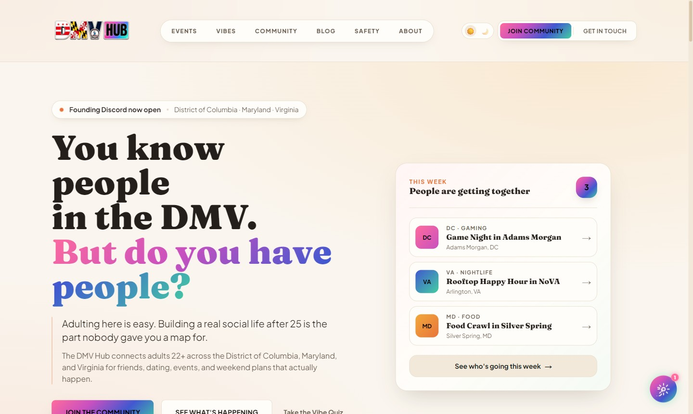

<div align="center">



<br>

The site behind **[The DMV Hub](https://thedmvhub.com)**, a community for adults 22+ across Washington DC, Maryland and Virginia who want a real social life: friends, events and weekend plans.


<br>



</div>

## What it does

The site is the front door. It turns search traffic and word of mouth into members of a curated Discord, where the community actually lives.

| Area | What is there |
|---|---|
| Home | Hero, a live "this week" events card, calls to join, a vibe quiz |
| Events | Typed event data, optionally driven by a published Google Sheet CSV with a built-in fallback |
| Vibes | Interest groups: food, gaming, fitness, dog parks, day trips and more |
| Community | How the Discord works, rules, safety and a code of conduct |
| Blog | Statically generated MDX posts written to answer real searches (SEO) |
| Forms | Contact and event submissions through Formspree, with server-side validation |
| Extras | FAQ console, gallery, games page, sitemap, robots, a health endpoint |

## Design and engineering choices

- **Two moods, one codebase.** A warm "casual" theme and a darker "party" theme share the same data and components through design tokens.
- **Content as typed data.** Events, vibes, FAQ and community info live in `data/` as typed modules, so changing content never means touching layout code.
- **Static first.** Pages and blog posts are prerendered. Only the form endpoints run on demand.
- **Safe by default.** The public config keeps optional services (support link, analytics) off until they are set, and no secrets are in the repo.
- **Checked before every deploy.** `npm run check` runs the type-check, lint with zero warnings, and a production build.

## Stack

Next.js (App Router), TypeScript, Tailwind CSS, MDX, Formspree, PostHog (optional), Playwright, deployed on Vercel.

## Run it

```bash
npm install
cp .env.example .env.local   # every value is optional
npm run dev
```

| Script | What it does |
|---|---|
| `npm run dev` | Local development |
| `npm run build` | Production build |
| `npm run check` | Type-check, lint and build |
| `npm run test:e2e` | Playwright end-to-end tests |

## Structure

```
app/          Routes (App Router)
components/   UI primitives and page sections
data/         Typed content and MDX blog posts
lib/          Helpers and config
styles/       Design tokens and global CSS
tests/e2e/    Playwright tests
public/       Static assets
```

## Author

Built by [Yassine Emhamed](https://www.yassine-emhamed.net), IT and Network Engineer.
